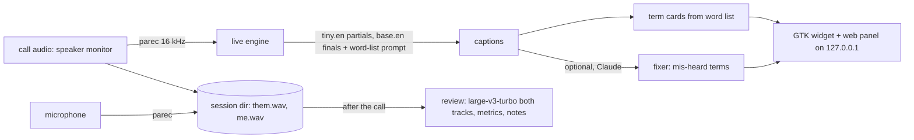

# meetcap

Live captions of the other side of a call, a jargon panel with spelling and meaning for technical terms, and notes plus timing metrics after it. It records the sound card rather than joining the meeting, so it is intended to work with any call app or browser tab (not yet tested on a real call).

> **Status: in testing, not finished.** The pieces below run on my desktop and a Debian tablet and the unit tests pass, but it has not been through a real two-sided call yet. See "What I did not check".

## Why I built it

I wanted captions of calls that are better than what call apps give me, with a card for any technical term it knows (spelling, one-line meaning, other names), and without a bot joining the call. So I wrote a tool that listens to the computer's own audio output and microphone and shows captions of the other side only. After the call it writes up what was discussed, what I committed to do, and timing numbers such as talk share and pause before replying. I started it on 2026-10-12 and built it with Claude Code.

## How it works



- `mt/tap.py`: two `parec` streams (them = default sink monitor, me = default mic), crash-safe raw files wrapped to WAV on stop. It warns when the call app is on a different device than the one being tapped.
- `mt/stt.py` / `mt/live.py`: faster-whisper. A tiny model gives grey partials, a base model gives the final line. Whisper's prompt is the word list. Fallback and no-speech segments are dropped, which removed invented filler lines.
- `mt/vocab.py`, `mt/core/`: the word list (a small example in `vocab/`, your own terms in `~/.config/meetcap/vocab.txt`, acronyms from an optional `--context` file, terms learned from past reviews) and the card lookup, which needs no model.
- `mt/fixer.py` (optional, Claude): fixes only clear mis-hearings of terms and writes cards for unknown jargon. It never writes replies for you.
- `mt/review.py`: after the call, full transcript of both tracks, timing metrics computed in code (talk share, pause before each reply, repeat requests), then a recap, your commitments (action items) and new terms written by Claude. Output: `transcript.md`, `notes.md`, `metrics.md`, `review.json`.
- A consent reminder stays on the panel until you dismiss it. Check the rules for the call you are on before recording.

## Numbers

Measured on a null-sink replay of one public 369 s jargon-heavy clip with human captions, 2026-10-12, n=53 caption lines. The runs are not like for like: the desktop was busy (load average 9-14, 4-thread synthetic encode), the tablet ran a 2-thread encode.

| machine | WER | commit lag median / p90 |
|---|---|---|
| tablet (Core Ultra 5 134U, Debian 13), 2-thread encode | 6.7 % | 1.6 / 2.5 s |
| desktop, busy, 4-thread encode | 8.3 % | 2.8 / 3.7 s |

Review check against a scripted synthetic two-track call: 12 of 13 checks hit (2026-10-12), measured on an earlier version of the mock script and check list; the shipped script has not been re-run. Full table, caveats and known issues: [RESULTS.md](RESULTS.md). These are clean-audio replays, not live calls.

## Install

Needs a Debian or Ubuntu computer (desktop, laptop or tablet) with PulseAudio or PipeWire and a screen. No account is needed for captions. A Claude login is only needed for the optional term fixer and the review write-up.

1. Get the code: `git clone` this repo and open a terminal in it.
2. Run `./install.sh --check`. It prints the `sudo apt install ...` and `pip install ...` lines for anything missing. Run them, then run `./install.sh` (no `--check`) to add a "meetcap" menu entry and download the small speech models.
3. Start it from the menu, or run `./bin/meetcap widget`.
4. In the window pick the output device the call plays on and your microphone, press Start. Press Stop at the end, then Review.

Command line:

| command | does |
|---|---|
| `meetcap widget` | window: Start/Stop, devices, options, captions + term cards, Review |
| `meetcap live --name weekly-sync --context agenda.txt` | record both sides, captions of them, panel at `http://127.0.0.1:7797` |
| `meetcap review <session>` | transcript, metrics, notes (`--no-llm` for local transcript and metrics only) |
| `meetcap mock <audio.wav> <captions.vtt>` | unattended test on a null sink, scored against human captions (nothing plays aloud) |
| `meetcap wrap <session>` | rebuild WAVs from raw files after a crash |

Sessions are saved under `~/.local/share/meetcap/sessions/`. Your own terms go in `~/.config/meetcap/vocab.txt` (format in `vocab/base.txt`). `vocab/` here is a small synthetic example, not a real list. `--lan` serves the panel to other devices with no login; anyone on the network can read it. On Wayland, "keep on top" needs a window rule.

Optional: set `MEETCAP_VOICE_UNIT=<name>.service` if a text-to-speech systemd user service of yours would otherwise talk into the call; it is stopped for the call and restarted after.

## Tests

Offline, no microphone, no account:

```
cd eval && PYTHONPATH=.. python3 -m unittest discover -p 'test_*.py'
```

They cover the review timing metrics and the word-list cards. `mock/make_twotrack.py` builds a synthetic two-track session (needs `piper` and a voice model, set `MEETCAP_PIPER_ME` / `MEETCAP_PIPER_THEM`); `mock/check_review.py` scores a review against its script.

## What I did not check

- A real call with my voice on the mic track, the voice-service gate in a real call, and review on real two-sided speech. Those were still open when I published.
- The term fixer and the review write-up (both call Claude) were not run from this copy.
- The widget, `meetcap live` and `meetcap mock` were not re-run from this copy after it was trimmed (the mock needs audio that is not included), so the numbers above come from the working copy this was cut from. Only the unit tests and a byte-compile of every module were run here.

## What is not included

- My recordings, transcripts, word list, and any personal source material. `vocab/` is a synthetic example.
- Audio clips for `meetcap mock`: use any clip with manual captions, for example `yt-dlp -x --audio-format wav --write-subs --sub-format vtt <url>` for a video you may use, converted to 16 kHz mono.
- Speech models (faster-whisper downloads them on first use) and TTS voices (get a piper voice from the piper project).
- The Android phone capture half and device sync scripts (device-specific, not verified on a real cellular call).

## Built with Claude Code

Written with Claude Code from my design decisions and tested against recorded clips; I chose the architecture (local speech-to-text, models only for optional extras).

## License

MIT, see [LICENSE](LICENSE).
